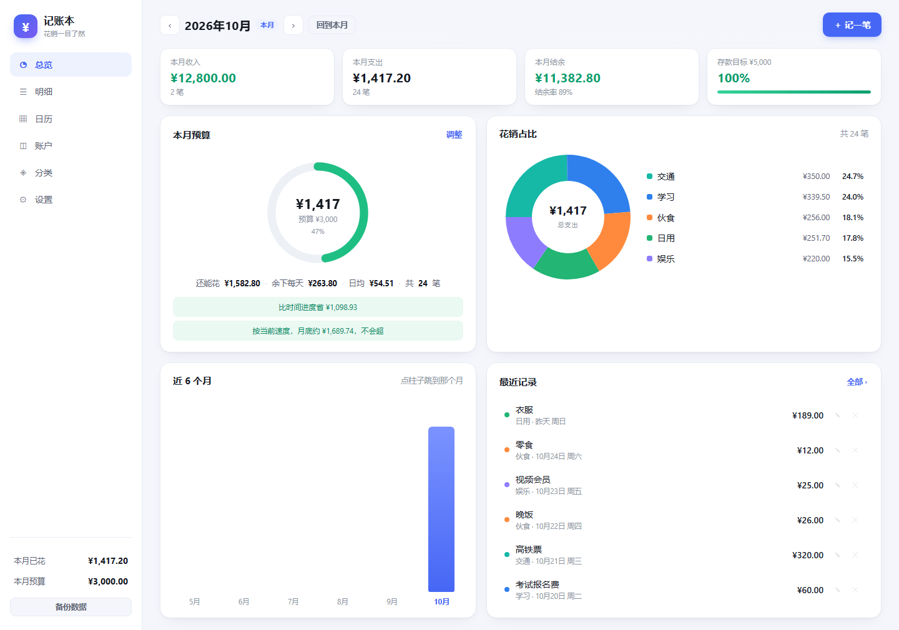
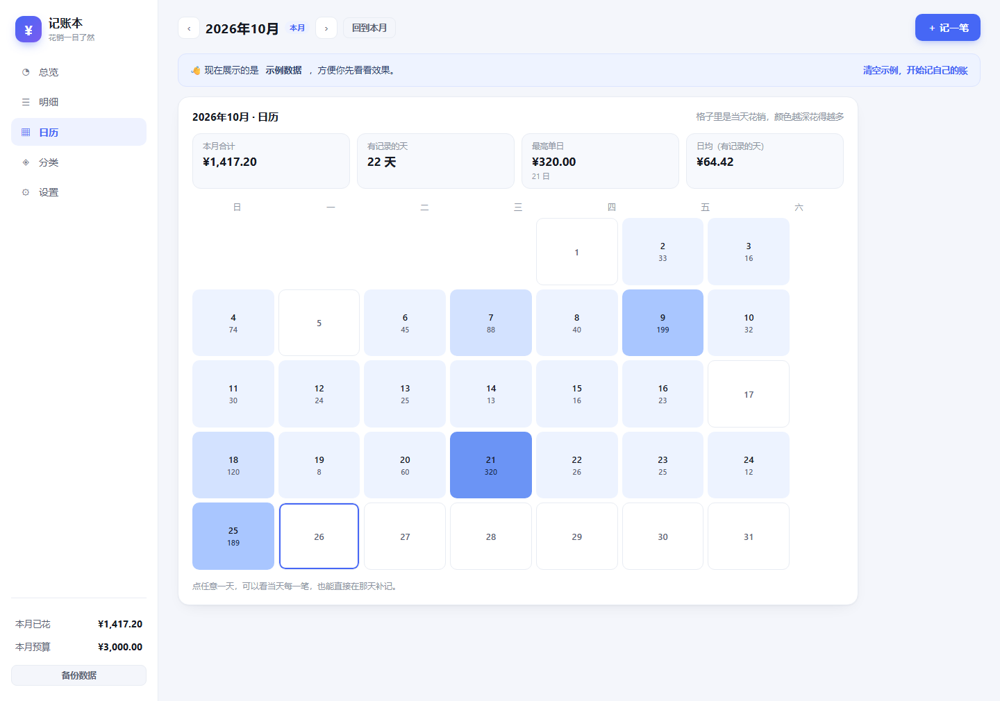
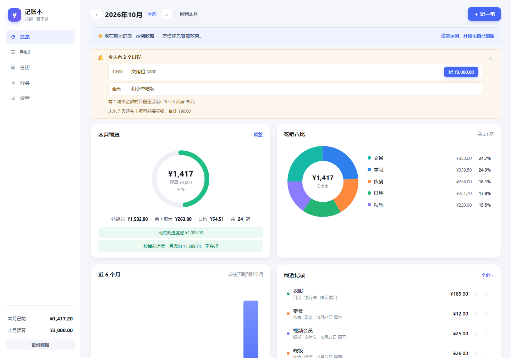
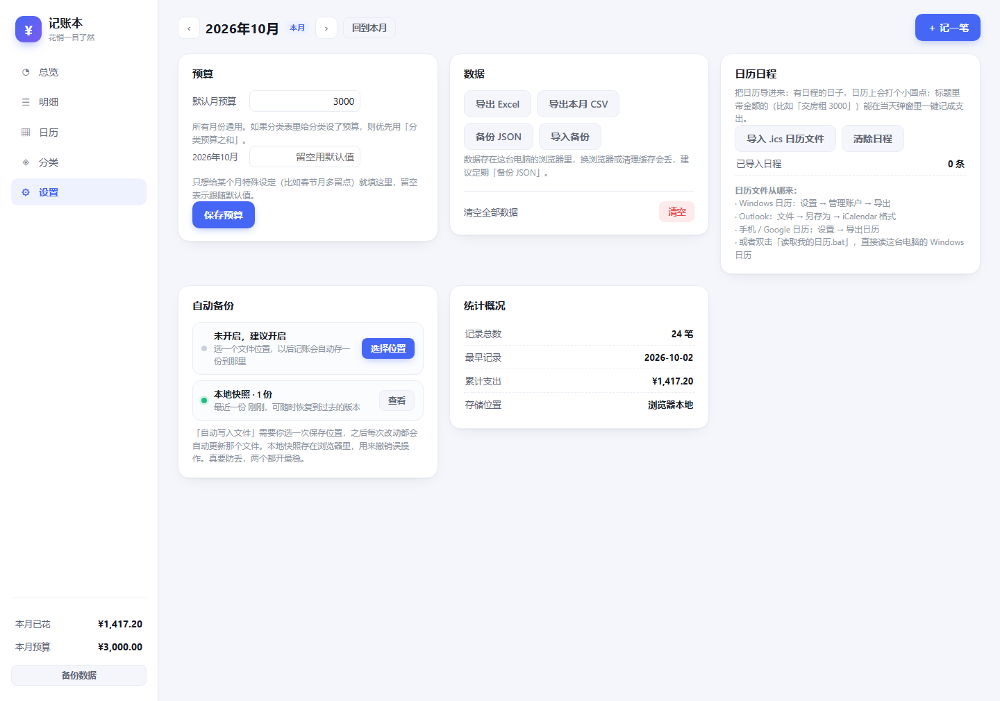
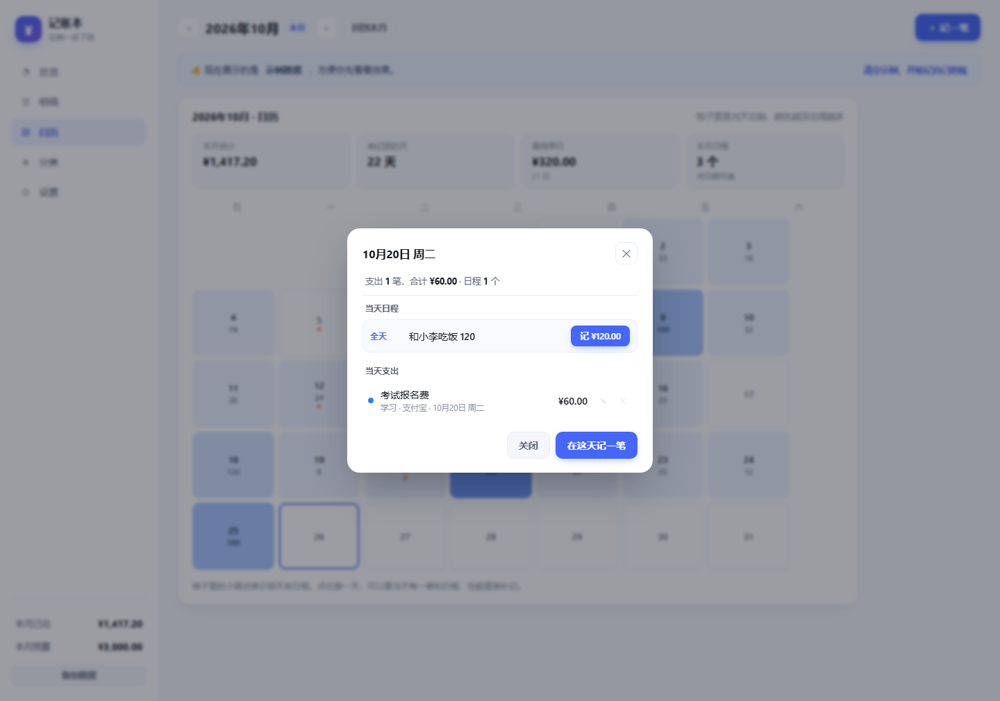

# 记账本 · MoneyBook

一个**单文件、离线、不用安装**的记账小工具。双击打开就能用，数据只存在你自己的电脑里。

> A single-file, offline personal finance tracker for Chinese users. No install, no account, no server. All data stays in your browser.



---

## 功能

| 模块 | 能做什么 |
|---|---|
| **预算** | 当月额度、剩余、每日可用、按时间进度对比、月底预测、超支变红 |
| **扇形图** | 九类花销占比，点扇区直接看该类明细，占比不足 2% 的小类自动合并 |
| **一句话记账** | 「午饭 25 微信」「昨天打车 18」「发工资 8000」自动识别金额、分类、账户、日期、收支类型 |
| **日历** | 热力月历，颜色越深当天花得越多；点某天看明细、就地补记 |
| **账户** | 现金 / 微信 / 支付宝 / 银行卡，各自算余额，支持转账 |
| **收入与结余** | 工资、兼职、红包、退款等收入分类，月度结余与结余率，存款目标进度 |
| **日历日程** | 导入 `.ics` 或直接读 Windows 日历，有日程的日子打点，带金额的日程可以一键记账 |
| **到期提醒** | 今天有日程、过了日期还没记的带金额日程、未来 7 天可能支出，自动在顶部提醒 |
| **自动备份** | ① 每次改动自动写入你指定的 JSON 文件 ② 浏览器内保留 14 份快照，可回滚 |
| **导出** | Excel、CSV、JSON 备份与恢复 |
| **AI 记账（可选）** | 规则认不出的复杂句子交给大模型解析（自己填 API Key，不填也能用） |

## 截图

| 日历视图 | 日程提醒 |
|---|---|
|  |  |

| 自动备份 | 日程明细 |
|---|---|
|  |  |

---

## 直接用

1. 下载本仓库的 [`MoneyBook.html`](MoneyBook.html)
2. 双击，用 Edge 或 Chrome 打开
3. 第一次会看到示例数据，点顶部「清空示例，开始记自己的账」

不需要安装、不需要注册、平时不需要联网。

**建议第一件事**：到「设置 → 自动备份」点「选择位置」，选个文件存备份。浏览器数据万一丢了还能恢复。

---

## 开发

零依赖，只要 Node.js（用来跑构建和测试）。

```bash
# 构建：把 core.js / app.js / styles.css 内联成一个 HTML
node build.mjs

# 核心逻辑自测（统计、占比、中文解析、ICS 解析）
node test-core.mjs

# 渲染自测（用最小 DOM 桩把六个页面和弹窗跑一遍）
node test-render.mjs

# 生成端到端测试页，再用浏览器打开它跑真实交互（83 项）
node gen-selftest.mjs
```

### 文件结构

```
core.js              纯函数：统计、占比、日历矩阵、ICS 解析、中文口语解析（可单独跑测试）
app.js               界面：渲染、事件、导入导出、备份、AI 调用
styles.css           全部样式
index.template.html  页面骨架，含三个占位符
build.mjs            把上面几个拼成 MoneyBook.html
test-core.mjs        核心逻辑自测
test-render.mjs      渲染自测
gen-selftest.mjs     生成端到端测试页
docs/                截图
```

### 改起来最方便的几个地方

| 想改什么 | 在哪 |
|---|---|
| 默认分类和颜色 | `core.js` → `DEFAULT_CATEGORIES` |
| 默认账户 | `core.js` → `DEFAULT_ACCOUNTS` |
| 口语识别的关键词（比如让它认识「螺蛳粉」） | `core.js` → `CAT_ALIASES` |
| 配色 | `styles.css` 开头的 `:root` |
| 扇形图合并阈值（现在 2%） | `app.js` → `C.pieSlices(st, 0.02)` |

---

## 已知限制

- **数据不跨设备同步**。存在浏览器 localStorage 里，换电脑要手动「备份 JSON」再「导入备份」。
- **清理浏览器缓存可能清掉数据**。一定要开自动备份。
- **多人不能共用一本账**。各记各的。
- **AI 记账受跨域限制**。部分服务不允许浏览器直连，会提示连接失败，规则记账不受影响。
- 手机能打开，但界面是给电脑设计的。

## 技术说明

- 纯原生 JavaScript，无框架、无构建依赖、无运行时依赖
- 图表用内联 SVG 手绘（扇形、圆环、柱状），不引第三方图表库
- 数据存 `localStorage`，文件句柄存 `IndexedDB`
- 自动写盘用 File System Access API（`showSaveFilePicker` + `createWritable`）
- 读 Windows 日历用 WinRT `AppointmentStore`（配 PowerShell 脚本）

## License

MIT
